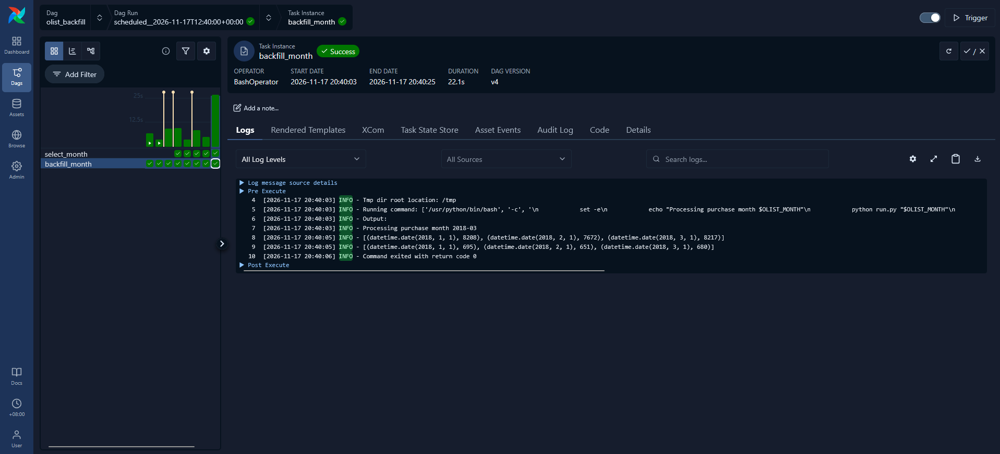
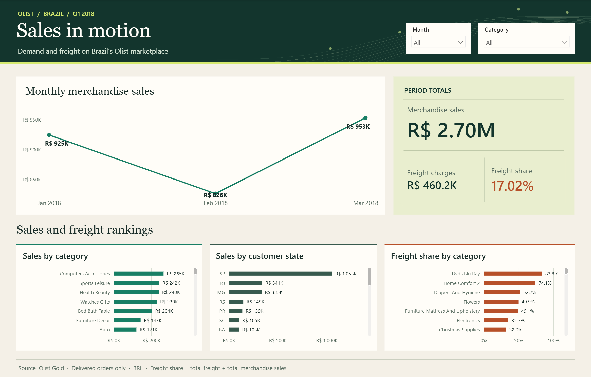

# Olist Sales and Freight Pipeline

A local data engineering demo built with Python, DuckDB SQL, and Parquet. It turns five CSVs from the Brazilian E-Commerce Public Dataset by Olist into reports on product sales and freight charges.

The source is a fixed snapshot. The pipeline simulates a historical backfill by selecting one purchase month at a time. It replaces that month’s Bronze batches on rerun, then rebuilds Silver and Gold from all months currently loaded in Bronze.

## Start the Airflow sandbox

With Docker Desktop running, start the sandbox from the repository root:

```powershell
docker compose up -d --build
```

The single container includes Airflow, DuckDB, the pipeline scripts, and the five source CSVs. Docker initializes the `olist-data` volume with the source files and keeps the generated outputs there. The `airflow-state` volume keeps Airflow’s settings and run history. `docker compose down` stops the sandbox and preserves both volumes.

### Try the pipeline by hand

The DAG starts paused on a fresh setup. Keep it paused while experimenting in the shell so scheduled runs and manual commands take turns writing the shared files.

```powershell
docker compose exec airflow bash
```

Inside the container, pick a purchase month and run each stage separately. Here’s January as an example:

```bash
python backfill.py 2018-01
ls data/bronze/orders data/bronze/order_items

python clean.py
ls data/silver

python aggregate.py
ls data/gold
```

Try another month by changing the argument to `backfill.py`. Silver and Gold rebuild from the months you’ve loaded. To query the Gold output you just generated, run:

```bash
python -c "from pathlib import Path; import duckdb; print(duckdb.sql(Path('reports/monthly_category_sales.sql').read_text()).limit(3).fetchall())"
```

### Try a scheduled backfill

Open the [Airflow UI](http://localhost:8080) and sign in as `admin`. Get the generated password from your local terminal:

```powershell
docker compose exec airflow cat /opt/airflow/simple_auth_manager_passwords.json.generated
```

Unpause `olist_backfill` when you’re ready for Airflow to take over. Every five minutes, `select_month` picks the next purchase month in its configured list and `backfill_month` runs `run.py` for it. The task records completed scheduled months in `data/.scheduled_backfills/` on the data volume. To rerun a particular month, use **Trigger** in the Airflow UI and set the `month` field.

The verified schedule processed January, February, and March 2018 in order. The following tick showed **Skipped** for both tasks because every month in the list had completed. Airflow still showed **Success** for the overall run.



To experiment with the cadence or month list, edit `schedule` or the default `scheduled_months` in [`dags/olist_backfill.py`](dags/olist_backfill.py), then run `docker compose up -d --build` again.

## Repository layout

```text
.
├── compose.yaml         # Starts the single-container Airflow sandbox
├── Dockerfile.airflow   # Builds the sandbox with the pipeline and source CSVs
├── Dockerfile           # Builds the standalone pipeline image
├── requirements.txt    # Pinned DuckDB dependency
├── backfill.py          # Selects a purchase month and writes Bronze CSVs
├── clean.py             # Joins the Bronze data and writes Silver Parquet
├── aggregate.py         # Summarizes sales and freight in Gold Parquet
├── run.py               # Runs all three stages for a chosen month
├── dags/                # Airflow workflow for manual and scheduled backfills
├── data/                # Original inputs and Bronze, Silver, and Gold files
├── reports/             # DuckDB SQL queries against Gold
├── powerbi/             # Editable Power BI project
├── docs/                # Airflow and Power BI screenshots
└── tests/               # Pipeline checks using small CSVs
```

## Source data

The original CSVs are in [`data/source/`](data/source/).

| CSV | What the pipeline uses |
| --- | --- |
| `olist_orders_dataset.csv` | Order ID, purchase timestamp, order status, and customer ID |
| `olist_order_items_dataset.csv` | Order and item IDs, product ID, item price, and freight charge |
| `olist_customers_dataset.csv` | Customer state |
| `olist_products_dataset.csv` | Product category |
| `product_category_name_translation.csv` | English category labels |

## Pipeline

| Layer | Script | Transformation and output |
| --- | --- | --- |
| Bronze | [`backfill.py`](backfill.py) | Selects orders from the start of the requested month up to the start of the next month. Uses those order IDs to select the corresponding items. Writes monthly CSVs under `data/bronze/orders/` and `data/bronze/order_items/`. Copies the three reference files into `data/bronze/reference/` on the first run. |
| Silver | [`clean.py`](clean.py) | Reads all Bronze batches and left joins orders, customers, products, and category translations to the items. The intended grain is one row per `(order_id, order_item_id)`. Stores the purchase month as a date and monetary values as decimals in `data/silver/order_items.parquet`. |
| Gold | [`aggregate.py`](aggregate.py) | Sums merchandise sales and freight charges for delivered items. Writes one row per purchase month, product category, and customer state to `data/gold/monthly_category_state_sales.parquet`. |

[`run.py`](run.py) accepts a purchase month in `YYYY-MM` format and runs the three stages in order. Silver uses the English category label when available, falls back to the original label, and uses `unknown` when the category is missing.

## Business questions

| Question | SQL report | Verified January 2018 result |
| --- | --- | --- |
| Which categories generate the most merchandise sales each month? | [Monthly category sales](reports/monthly_category_sales.sql) | `sports_leisure` led at R$86,172.83. |
| Which customer states drive sales for a selected month and category? | [Category sales by state](reports/category_sales_by_state.sql) | For `sports_leisure`, São Paulo (SP) led at R$30,686.32. |
| Which categories have the highest freight charges relative to merchandise sales? | [Freight share by category](reports/freight_share_by_category.sql) | `dvds_blu_ray` led at 93.94%. |

Merchandise sales sum item prices in Brazilian reais (BRL). The freight report divides total freight charges by total merchandise sales after summing both across customer states.

## Verified backfill results

| Purchase month | Bronze orders | Silver items | Gold rows | Merchandise sales | Freight charges |
| --- | ---: | ---: | ---: | ---: | ---: |
| January 2018 | 7,269 | 8,208 | 695 | R$924,645.00 | R$153,242.46 |
| February 2018 | 6,728 | 7,672 | 651 | R$826,437.13 | R$139,731.28 |
| March 2018 | 7,211 | 8,217 | 680 | R$953,356.25 | R$167,241.99 |

After loading all three months, rerunning January preserved the Silver and Gold row counts and every value in the 2,026 Gold rows. The Gold comparison sorted by month, category, and state before comparing the rows.

The [automated pipeline test](tests/test_pipeline.py) uses small CSVs in a temporary project. It verifies which orders and items land in the January Bronze batches, checks that Silver preserves each item key exactly once, and compares Gold sales and freight against exact expected totals. It also verifies that rerunning January preserves the January and February Gold rows.

## Run reports and tests locally

With Python 3.11 available, create an environment and install the same DuckDB release used in Docker.

```powershell
python -m venv .venv
.\.venv\Scripts\python.exe -m pip install -r requirements.txt
```

From the repository root, preview three rows from the report using the Gold file committed with the demo. Change the SQL filename to run either of the other reports.

```powershell
.\.venv\Scripts\python.exe -c "from pathlib import Path; import duckdb; print(duckdb.sql(Path('reports/monthly_category_sales.sql').read_text(encoding='utf-8-sig')).limit(3).fetchall())"
```

To run the automated pipeline test:

```powershell
.\.venv\Scripts\python.exe -m unittest discover -s tests -v
```

## Power BI report

**Sales in motion** visualizes delivered orders from January through March 2018. Use the month and category filters to explore the sales trend, sales rankings by category and customer state, and freight charges as a share of merchandise sales.



1. Open [`powerbi/OlistGold.pbip`](powerbi/OlistGold.pbip) in Power BI Desktop.
2. Select **Home → Refresh** on first open to load the embedded Gold snapshot.

The report uses the 2,026 rows from the verified Gold Parquet snapshot. Refresh loads that copy into Power BI. Incorporating a new backfill requires updating the embedded snapshot.

## What I learned

- **Decide what one row represents.** I kept Silver at one row per order item and checked the item keys after joining. A row count alone can miss a join that drops one item and duplicates another.
- **Test what happens when a job runs twice.** Rerunning January taught me to compare the actual Gold rows as well as the counts. That gave me a way to verify that a backfill preserved the results for all three months.
- **Separate setup from scheduling.** Docker gave me the same environment from a fresh clone. Airflow let me schedule the scripts I had already tested by hand. When a run showed Success but repeated January, the logs helped me trace the missing completion marker.
- **Check dashboard measures against SQL.** I verified the Power BI values against Gold and calculated freight share by dividing total freight by total merchandise sales.

## Milestones

- [x] Build the January pipeline from the source CSVs through Gold and verify three SQL reports.
- [x] Add a monthly runner, backfill February and March, and verify the January rerun.
- [x] Add an automated rerun test with sample CSVs.
- [x] Check the month boundary in the January Bronze orders and items batches.
- [x] Check Silver join cardinality and exact Gold sales and freight values.
- [x] Package the pipeline in Docker, run the test in the image, and verify January from a clean checkout.
- [x] Document how to build the image, run a backfill, run the test, and query the reports.
- [x] Build and verify the Power BI report against the Gold snapshot.
- [x] Package the single-container Airflow sandbox and verify the manual and scheduled workflows.

## Data attribution

The source CSVs are from the [Brazilian E-Commerce Public Dataset by Olist](https://www.kaggle.com/datasets/olistbr/brazilian-ecommerce), licensed under [CC BY-NC-SA 4.0](https://creativecommons.org/licenses/by-nc-sa/4.0/). The pipeline derives monthly Bronze batches and Silver and Gold Parquet files from that data.
